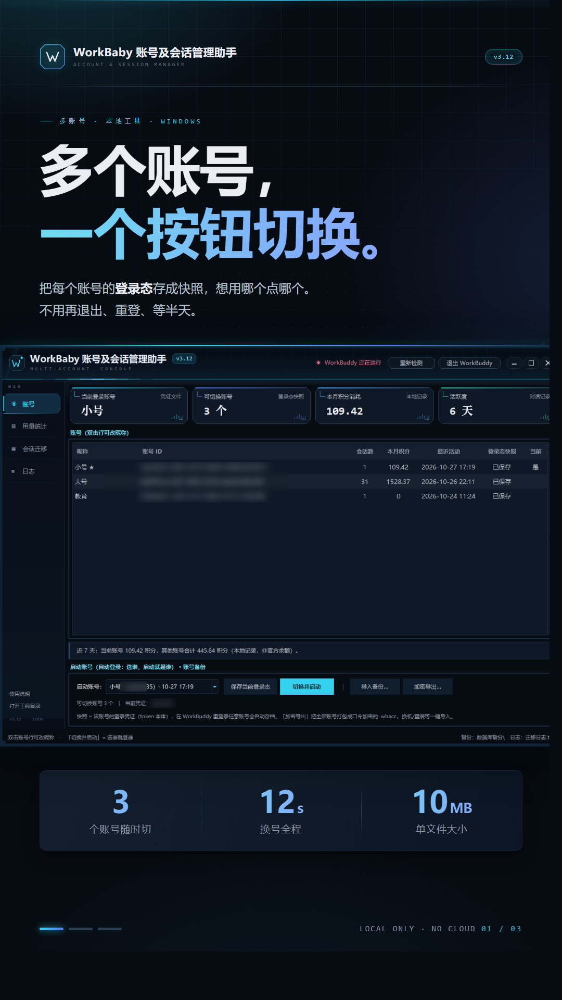

# WorkBaby 账号及会话管理助手

面向「一台电脑登录过多个账号」这个场景的本地辅助工具：**一键换号、会话搬家、用量统计**。
界面为深色 HUD 风格，纯 Python 标准库实现，单文件 exe 双击即用。

当前版本：**v3.12**

> **本项目是非官方第三方工具，与 WorkBuddy 官方（腾讯）没有任何隶属、合作、授权或背书关系。**
> 详见下方免责声明。

<p align="center">
  
  
  
</p>

---

## 免责声明

请在使用前逐条阅读。下载、运行或修改本项目的任何部分，即视为你已理解并接受以下全部内容。

1. **无关联声明。** 本项目由个人开发者独立编写，与 WorkBuddy / CodeBuddy 的开发者、运营方及其关联公司**没有任何隶属、合作、赞助或背书关系**。文中出现的 "WorkBuddy"、"CodeBuddy" 等名称与商标，归其各自权利人所有，本项目**仅作描述性提及**（用来说明本工具服务于该软件），不主张任何商标权或其他权利，也不代表官方立场。

2. **实现方式与风险。** 本工具的功能建立在**读写你本机的本地文件**之上（账号资料副本、本地会话数据库等）。这类操作**可能违反该软件的用户协议**，也可能因为软件升级而随时失效。是否使用、如何使用，由你自行判断并承担全部后果。

3. **数据与隐私。** 本工具**不联网、不上传任何数据、不收集任何使用统计**。所有数据都留在你自己的电脑上。但请注意：工具导出的账号备份文件内含**可直接登录的凭证**，其效力等同于密码，请妥善保管，**不要发送给任何人**，也不建议上传到网盘或代码仓库。

4. **责任限制。** 本软件按「现状」提供，不附带任何明示或默示的担保。作者不对使用本工具造成的任何直接或间接损失承担责任，包括但不限于数据丢失、会话异常、账号被限制或封禁、违反第三方协议所产生的后果。

5. **可接受使用。** 请仅用于管理**你本人**的账号。**禁止**用于账号买卖、代登录、批量养号、绕过风控等违规或商业用途。因滥用产生的法律责任由使用者自负。

6. **合规提示。** 不同国家和地区对软件互操作、账号凭证处理的规则不同，请自行确认你所在地区的法律与平台规则。如果你不接受上述任一条款，请立即停止使用并删除本软件。

---

## 功能

| 模块 | 说明 |
|---|---|
| **账号切换** | 把每个账号的登录态各存一份快照，之后点一下就切过去并以该账号启动；切换前自动备份当前状态 |
| **会话迁移 / 复制** | 把会话的归属改到另一个账号。迁移＝过户（原账号不再显示），复制＝两边各留一份 |
| **定时任务过户** | 把定时任务的归属账号一并改过去 |
| **用量统计** | 积分消耗、Token 用量、每日柱状图、账号排行、模型排行、限流与预计解封时间 |
| **账号备份** | 全部账号加密导出为单文件（PBKDF2 + HMAC-SHA256），换机导入 |
| **界面** | 无边框深色 HUD、自绘窗口控件、自绘弹窗，纯 Canvas 绘制，零第三方 UI 库 |

## 运行环境

- Windows 10 / 11
- **免安装**：从本仓库 [Releases](../../releases) 下载 `WorkBaby账号及会话管理助手_v3.12.exe` 双击运行（exe 体积 11 MB，不进 Git 仓库）
- **源码运行**：Python 3.9+（**只用标准库**，不需要 pip 安装任何东西）

## 快速开始

1. 完全退出 WorkBuddy（工具顶部会实时检测，未退出不允许写库；也可以点工具右上角「退出 WorkBuddy」由它代劳）。
2. 双击 exe 打开工具。
3. **先在 WorkBuddy 里登录账号 A**，回到工具点「保存当前登录态」。
4. 换成账号 B 登录，再点一次「保存当前登录态」。有几个账号就各存一次。
5. 以后在「账号」页选一个账号点「切换并启动」，就能直接以那个账号启动。

会话搬家：切到「会话迁移」页 → 勾选会话 → 选目标账号 → 「开始执行」。
**执行前请务必退出 WorkBuddy**，否则应用会用内存中的数据把改动覆盖回去。

## 数据与隐私

所有生成的文件都在 exe 同一个文件夹里，删掉这个文件夹即彻底清除：

```
登录态快照\        各账号的登录凭证快照（含辅助数据）
数据库备份\        每次改动前的自动备份，出问题可从这里还原
迁移日志.txt       操作记录（只记做了什么，不记聊天内容）
tool-config.json   账号昵称等本地设置
```

工具**不发起任何网络请求**，也没有自动更新、遥测、崩溃上报。想验证可以直接读源码搜 `socket` / `urllib`。

## 已知限制

- 只支持**同一台机器、同一个 Windows 用户**下的多账号；换机导入后若提示需要重新登录，在该机登录一次并重存快照即可。
- 账号长期不登录，其 refreshToken 会过期，需要重新登录一次。
- 宿主软件升级后内部结构可能变化，届时工具会失效，需要跟进适配。
- 标记为 cloud 传输的会话，内容在服务器上，无法在本地账号之间迁移。
- 迁移体积很大的会话需要相应空闲磁盘空间（工具会提前提示）。

## 从源码运行 / 自行打包

```bat
:: 直接运行
python 账号互通工具.py

:: 打包成单文件 exe（自动读取源码里的版本号命名）
python 打包exe.py
```

打包依赖 PyInstaller（`pip install pyinstaller`）。打包脚本已排除 PIL / numpy / pandas 等无用依赖，产物约 10.8 MB。

### 仓库结构

```
账号互通工具.py     主程序：GUI 与全部业务逻辑
wb_usage.py        会话数据库读取、用量统计
wb_crypto.py       账号备份文件的加解密（PBKDF2 + HMAC-SHA256）
打包exe.py          PyInstaller 打包脚本
双击启动.bat        以源码方式启动
打包exe.bat         双击打包
使用说明.txt        面向使用者的纯文本说明
app.ico            程序图标
docs/              README 用的示意图
```

> **注意**：运行后会在程序目录生成 `登录态快照/`、`数据库备份/`、`tool-config.json`、`迁移日志.txt`。
> 这些**都已写进 `.gitignore`**。其中 `登录态快照/` 内含可直接登录的凭证，**绝对不要提交或分享**。

## 许可

代码以 **MIT License** 发布，全文见 [LICENSE](LICENSE)。

- 项目为独立实现，**未包含任何第三方库**，全部依赖均为 Python 标准库；打包工具 PyInstaller 采用 GPL 并附带明确的例外条款，允许打包分发闭源程序，不要求本项目开源。
- 项目内**不包含宿主软件的任何官方资源、图标或字体**。
- 如果你要二次分发，请一并保留本 README 的免责声明。

## 反馈

欢迎提 issue 说明使用场景与问题。请**不要**在 issue 或截图里粘贴任何凭证内容、token 或完整的本地路径。
